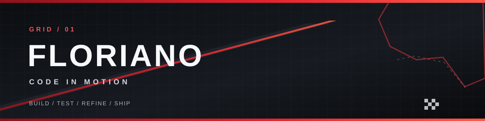
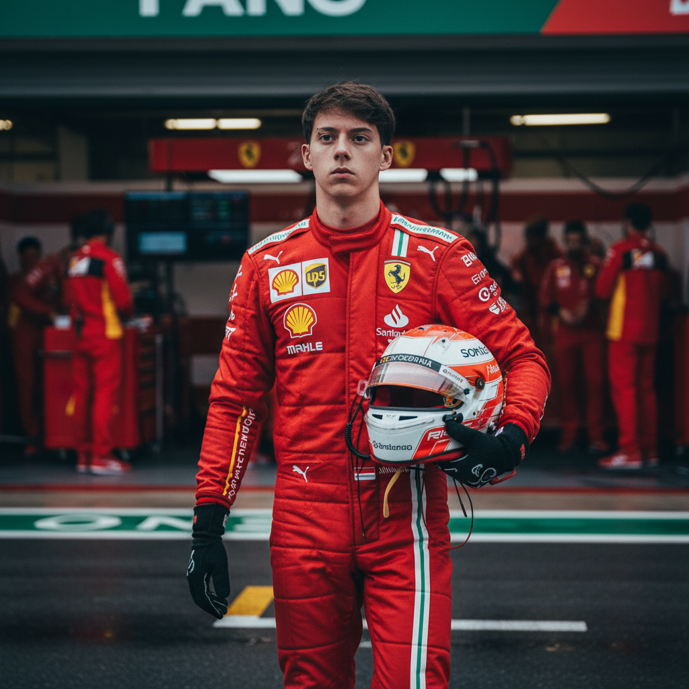



  

  

# Olá, eu sou o Floriano 👋

Gosto de transformar ideias em produtos que as pessoas possam usar. Meu trabalho em código mistura interface, automação e ferramentas criativas. Aqui, a inspiração vem das pistas: **preparar, testar, ajustar e seguir em frente**.

### 🏁 Projeto no grid

**[Cortelol](https://github.com/Floraino/Cortelol)** — aplicativo desktop de código aberto que ajuda criadores a transformar podcasts longos em clipes curtos revisados. Reúne transcrição, descoberta de momentos, edição, legendas, enquadramento vertical e exportação local. O projeto está em desenvolvimento e recebe melhorias contínuas.

`TypeScript` · `React` · `Rust` · `Tauri` · `FFmpeg`

### ⚙️ Como eu construo

- **Produto primeiro:** começar pelo problema real e deixar o fluxo claro.
- **Controle nas mãos de quem usa:** IA sugere; a pessoa revisa antes de exportar ou publicar.
- **Iteração constante:** cada volta revela algo para melhorar na próxima.

### 📡 Rádio da equipe

Conheça o [código do Cortelol](https://github.com/Floraino/Cortelol), acompanhe o [andamento do projeto](https://github.com/Floraino/Cortelol/blob/main/PLAN.md) ou abra uma [issue](https://github.com/Floraino/Cortelol/issues) com uma ideia ou problema.

Perfil com estética inspirada no automobilismo. Sem associação com equipes ou campeonatos.

